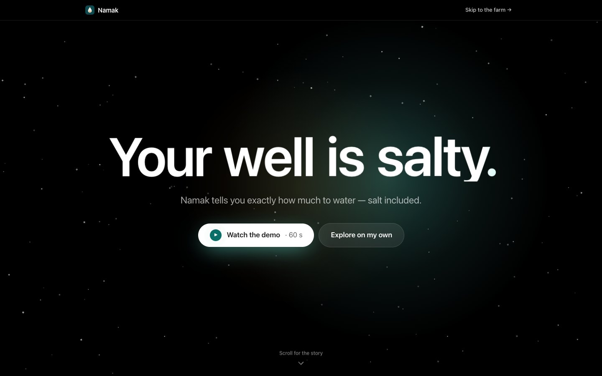
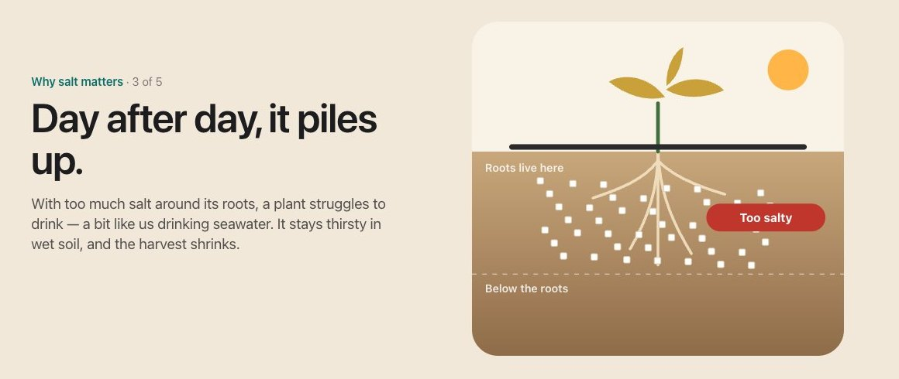
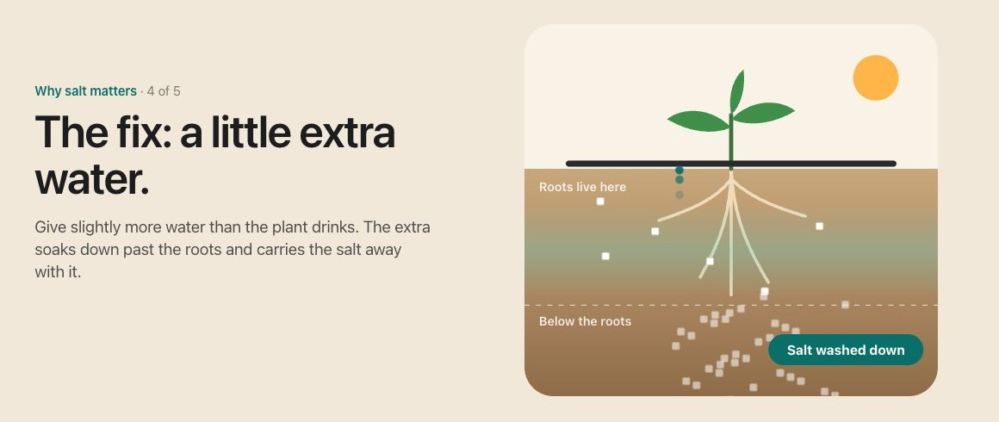
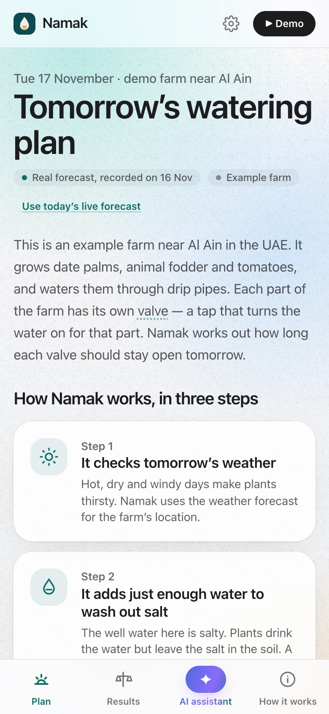
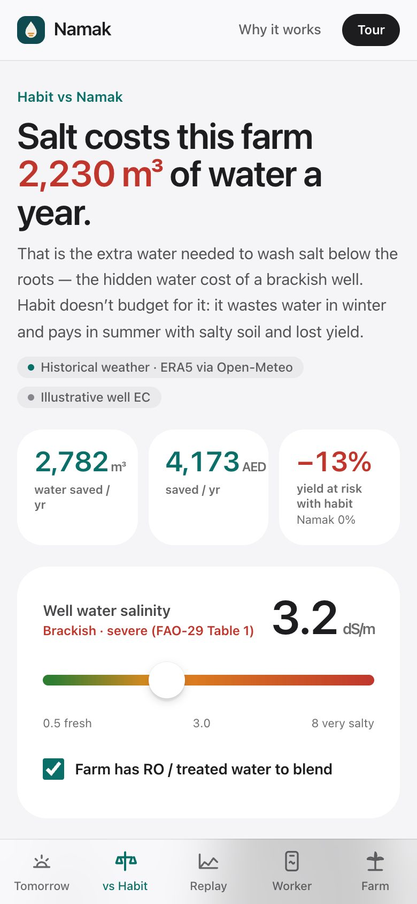

<div align="center">


# Namak

### Salt-aware irrigation for desert farms

*Your well is salty. Namak tells you exactly how much to water — salt included — and sends the plan to the farm worker as a voice message in their own language.*

<br>

<a href="https://namak-phi.vercel.app"></a>

**[namak-phi.vercel.app](https://namak-phi.vercel.app)** · no login · press **Watch the demo** for a 60-second guided tour

<br>


<br>

<a href="https://namak-phi.vercel.app"></a>

</div>

<br>

## At a glance

| | |
|---|---|
| **The problem** | Desert farms water from salty wells. Every watering leaves salt in the soil, so farmers must pour extra water to wash it out — and they **guess** how much. |
| **What Namak does** | Works out tomorrow’s exact minutes for every valve from the real weather forecast, the crop and the well’s saltiness — water for the plant **plus** just enough to wash the salt away. |
| **Who it reaches** | The person who actually opens the valves: a hired worker, often in another language. Namak sends the plan as a **voice message in English, Hindi or Arabic**, written and voiced by Gemini. |
| **The result** | Replayed on a real year of weather: **19 % less water**, palms too salty on **1 day instead of 120**, tomato yield **87 % → 100 %**. |
| **What it costs** | A ~AED 100 salt meter (EC pen). No sensors, no subscription, works with no signal. |

## The problem, from the start

<table>
<tr>
<td width="50%"></td>
<td width="50%"></td>
</tr>
<tr>
<td><b>The water goes, the salt stays.</b> Plants drink the well water and the sun dries the soil, but the salt is left behind. Day after day it piles up around the roots until the plant can’t drink — even in wet soil — and the harvest shrinks.</td>
<td><b>The fix is a little extra water</b> that soaks past the roots and carries the salt down. Too little and the salt comes back; too much wastes water the desert can’t spare. The right amount changes with the well, the crop and every day’s weather.</td>
</tr>
</table>

Everyone asks *“how much water does the crop need?”* In the desert that is only half the question. Namak is built around
three problems hidden inside it:

1. **Salt is the hidden water cost.** The extra water needed to wash salt out — FAO’s *leaching requirement* — is real,
   large and never calculated on the farm. On the example farm it is **2,230 m³ a year, almost a fifth of all its water.**
2. **Salt builds up like a debt.** Watering by habit (the same minutes every day) over-waters in winter and under-washes in
   summer, so salt accumulates for months. Namak keeps a running **Salt Debt** for each crop and pays it back on the
   **coolest days of the week**, when plants drink least — timing the UN’s FAO explicitly recommends.
3. **The decision-maker isn’t at the valve.** The owner plans; a hired worker opens the valves. Namak speaks to the
   worker directly, by voice, in their language — and the worker closes the loop with one photo of a cheap salt meter.

## What’s in the app

<p align="center">
&nbsp;
&nbsp;
&nbsp;

</p>

| Screen | What you see |
|---|---|
| **Story** (first screen) | “Your well is salty.” — a scroll-through explanation of the problem, with a 60-second **guided demo** that drives the real app by itself. |
| **Plan** | Tomorrow’s total watering time and a card per valve (“Valve 1 · Palms · 95 min · 00:00 → 01:35”) with a one-line *why*, the Salt Debt gauge and the 7-day plan with repayment days marked. |
| **Results · Water saved** | A real year at the farm. Drag the **well-salt slider** and watch the salt’s share of the water, the water and money saved and the yield risk change live; if the well is too salty for a crop, Namak suggests a blend with cleaner water. |
| **Results · Last year replayed** | Last year re-run day by day on **ERA5 reanalysis weather**: water used and root-zone salt, habit vs Namak. The proof that the decision beats the guess. |
| **✦ AI assistant** | The farmer’s chat with Namak on a phone: pick a language → send a photo of the salt meter → Gemini reads it → confirm → the plan recalculates (before/after shown) → Gemini writes tomorrow’s times in that language and sends them as a **voice message**. |
| **How it works** | Sources, formulas, crop constants, what is real vs illustrative, limits and cost. |
| **Farm** (gear icon) | Location, well salt level, valves, crops, emitters, soil test and the worker’s habit. Saved on the phone. |

## Does it beat the guess?

An example farm near Al Ain (30 date palms, 1,000 m² fodder, 600 m² tomato; well 3.2 dS/m), replayed on **real ERA5
weather, 11 Nov 2025 – 10 Nov 2026** (tomato: its Oct–Mar season). *Habit* = the worker’s summer setting left on all year.

| | Habit | Namak |
|---|---:|---:|
| Water, whole farm, 12 months | 14,686 m³ | **11,904 m³ (−19 %, ≈ AED 4,170 / yr)** |
| Of which spent washing out salt | not budgeted | **2,230 m³** — the hidden cost, made visible |
| Date palm: days with root-zone salt over the limit | 120 | **1** |
| Fodder: days over the limit | 89 | **0** |
| Tomato: salt-limited yield | 87 % | **100 %** |

These numbers are asserted in [`src/engine/demo-claims.test.ts`](src/engine/demo-claims.test.ts), so they cannot drift.
Namak is **not** always the lower-water option: for the salt-sensitive tomato it uses ~2 % *more* water (with 36 %
cleaner RO water in the blend) and saves the crop. Water goes where the salt demands it, not where habit puts it.

## How it works


- **Engine** — pure TypeScript in [`src/engine`](src/engine): crop water need (FAO-56), the leaching fraction (FAO-29),
  a daily root-zone salt balance (FAO-61) and a planner that repays the salt debt on the lowest-evaporation days. Every
  crop constant cites its FAO table; 84 tests include FAO’s own worked examples.
- **Data** — the Open-Meteo forecast and ERA5 history. A recorded snapshot is bundled, so every screen works offline and
  the demo shows the same numbers every day.
- **AI** — three small server-side routes on Vercel. The engine decides the minutes; AI only translates, speaks and reads
  a meter display.

## How AI is used — Google Gemini, server-side only

| Route | Model | What it does | Guard rails |
|---|---|---|---|
| `/api/instruct` | `gemini-4-hydrogen` | Turns the plan into two short sentences in the worker’s language | Every minute and start time is checked against the plan; any mismatch, timeout or no signal → a fixed template |
| `/api/voice` | `gemini-3.8-flash-lite-tts` | Reads those sentences aloud as a voice message | Cached on the phone; fallback: the phone’s own voice |
| `/api/read-ec` | `gemini-4-hydrogen` (vision, strict JSON) | Reads the number and unit off a salt-meter photo | Units converted (mS/cm = dS/m, µS/cm ÷ 1000), only 0–20 dS/m accepted, the farmer confirms before anything changes |

The API key lives only in Vercel’s environment; per-IP limits and a daily cap protect it. Gemini’s output for the demo
(9 voice messages in 3 languages and the readings of the 3 example meter photos) was generated once and is reused from
[`public/demo`](public/demo) and [`src/data/demoAssets.json`](src/data/demoAssets.json) — the guided demo makes **no AI
calls**, and a test fails if an engine change ever makes a saved message disagree with the plan.

## Built for the desert

- **Saves water** — −19 % on the example farm over a real year, with the salt share of every litre made visible.
- **Weak signal, little time** — an installable web app that works fully offline after one visit (“Offline — plan synced …”
  banner). One sync a week covers a 7-day plan. The worker needs no reading and no app: just a voice message.
- **Affordable** — a ~AED 100 EC pen is the only hardware. AI calls are tiny and capped.

## What is real, what is illustrative

| Real | Illustrative |
|---|---|
| 7-day forecast: Open-Meteo (ET0, max temperature, min humidity, wind, sunrise) | The example farm’s layout, crops, emitters and the worker’s habit |
| Historical weather: ERA5 reanalysis via Open-Meteo | Well salt level (3.2 dS/m) and soil tests |
| FAO crop and salt constants and equations | Water price (AED 1.5 / m³) and the clean-water blend source |
| Gemini’s messages, voices and meter readings | The three example meter photos are drawings made for the demo |

Every number in the app carries a source label (“Live forecast · Open-Meteo”, “Historical weather · ERA5”, “Illustrative well EC”).

<details>
<summary><b>The science in detail — formulas, FAO validation, debt repayment, crop constants</b></summary>

<br>

#### Formulas (units: mm over crop area, 1 mm on 1 m² = 1 L; EC in dS/m)

| Step | Formula | Source |
|---|---|---|
| Crop water | ETc = Kc × ET0 | FAO-56 eq. 56 |
| Kc curve | flat Kc ini → linear to Kc mid → flat → linear to Kc end | FAO-56 ch. 6, Tables 11–12 |
| Climate adjustment | Kc = Kc(tab) + [0.04(u2−2) − 0.004(RHmin−45)](h/3)^0.3 | FAO-56 eq. 62 |
| Wind at 2 m | u2 = u10 · 4.87 / ln(67.8·10 − 5.42) | FAO-56 eq. 47 |
| Leaching requirement (cross-check) | LR = ECw / (5·ECe − ECw) | FAO-29 eq. 9 |
| Leaching fraction used | LF such that steady-state four-layer root-zone ECe = target (40-30-20-10 % uptake) | FAO-29 / FAO 1985b; FAO-61 Annex 4 Table A4.1 |
| Gross water | Gross = ETc / ((1 − LF) × drip efficiency) | FAO-29 eq. 7 |
| Valve time | minutes = litres / (emitters × L/h) × 60 | — |
| Salt Debt (daily) | ΔS = (IW·ECiw − R·S/Wfc) / (1 + R/2Wfc), four quarters, ECe ≈ ECsw/2 | FAO-61 Annex 4 eq. 19–23 |
| Yield | Y = 100 − b·(ECe − threshold) | FAO-29 Table 4 / FAO-56 Table 23 |
| Target ECe | 100 % yield ECe if ECw > 1.5 dS/m, else 90 % yield ECe | FAO-29 §2.4.2 |
| Blend | x = (ECwell − ECmax) / (ECwell − ECclean); ECmax keeps LF ≤ 0.25 | mass balance; FAO-29 (“LR > 0.25–0.30 may not be practical”) |

**Validation against FAO’s own worked numbers** (all in the test suite):
FAO-29 Example 3 (LR 0.106 / 0.164; 800 mm ET → 889 mm applied) · FAO-61 Table A4.1 concentration factors
(LF 0.05 → 3.2, 0.10 → 2.1, 0.15 → 1.6, 0.20 → 1.3, 0.30 → 1.0) · FAO-56 slope at FAO-29’s 90 % ECe gives 90 ± 2 % yield
for every crop.

**Why not just FAO-29 eq. 9?** Run inside the FAO-61 salt model, eq. 9’s quick estimate settles slightly *above* the
crop limit (≈ 4.5 vs 4.0 dS/m for palms at 3.2 dS/m water). Namak uses FAO-29’s more exact four-layer method so the
daily plan and the debt model agree; eq. 9 is still computed and shown for comparison.

#### Debt repayment: is it allowed?

Yes. FAO-29 §2.4.2: leaching *“can be done at each irrigation, each alternate irrigation or less frequently, such as
seasonally … as necessary to keep salinity below the threshold”*, and *“schedule leachings at periods of low crop water
use”* / *“leach during the cool season instead of the warm”*. Namak therefore applies maintenance leaching every day and,
when the root zone is (or is about to be) over the limit, adds repayment on the **lowest-ET0 days** of the week, at most
doubling a day’s water so no valve is flooded.

Valves run one after another (one pump) at night, finishing by sunrise. Night/pre-dawn timing is a design choice, not an
FAO number: evaporation and wind losses are lowest and the water is in the root zone before the afternoon peak.

#### Crop constants (all read from the primary FAO pages on 16 Nov 2026)

| Crop | Kc ini / mid / end (FAO-56 T12) | Stages, days (FAO-56 T11) | Root depth used, m (T22) | ECe 100 % / 90 % / 0 % (FAO-29 T4) | b, %/dS·m⁻¹ (FAO-56 T23) |
|---|---|---|---|---|---|
| Date palm | 0.90 / 0.95 / 0.95 | perennial | 1.5 (of 1.5–2.5) | 4.0 / 6.8 / 32 | 3.6 |
| Tomato | 0.6 / 1.15 / 0.80 (range 0.70–0.90) | 35/45/70/30 (Oct/Nov, arid) | 0.7 (of 0.7–1.5) | 2.5 / 3.5 / 13 | 9.0 |
| Cucumber | 0.6 / 1.00 / 0.75 | 25/35/50/20 (Nov/Feb, arid) | 0.7 (of 0.7–1.2) | 2.5 / 3.3 / 10 | 13.0 (range 7–13) |
| Lettuce | 0.7 / 1.00 / 0.95 | 25/35/30/10 (Oct/Nov, arid) | 0.3 (of 0.3–0.5) | 1.3 / 2.1 / 9.0 | 12.0 |
| Fodder grass (Bermuda) | 0.55 / 1.00 / 0.85 | perennial | 1.0 (of 1.0–1.5) | 6.9 / 8.5 / 23 | 6.4 |

Other constants: sand field capacity θFC = 0.12 (FAO-56 Table 19 midpoint of 0.07–0.17); practical LR limit 0.25
(FAO-29). **UNVERIFIED:** drip application efficiency 0.90 — a common design value we did not find in a primary FAO
table; it is editable in Farm setup. Rhodes grass (the usual UAE fodder) is in neither FAO salt table, so Bermuda grass,
the nearest listed fodder grass, stands in for it.

</details>

<details>
<summary><b>Assumptions & limitations</b></summary>

<br>

- Salt model: complete mixing within four root-zone layers, 40-30-20-10 % uptake, no capillary rise, adequate drainage,
  no salt from fertiliser or rain, no precipitation/dissolution chemistry; daily time step; soil back at field capacity
  after each drip irrigation.
- Kc values are for healthy full cover; young or sparse plantings use less. Root depth uses the low end of FAO ranges.
- Yield response covers salinity only (not water stress, not sodium/chloride/boron toxicity — FAO-29 §4).
- The EC pen measures **water**, so the photo updates the well EC; soil salinity is modelled between soil tests.
- Season Replay gives Namak a perfect 7-day forecast (the recorded weather); real forecasts are less accurate.
- The demo farm is illustrative and has not been field-validated. Non-English templates have not yet been checked by
  native speakers.

</details>

## Run it locally

```bash
npm install
npm test        # 84 tests: engine, FAO cross-checks, demo claims, weather fallback, instruction checks
npm run dev     # http://localhost:5173 (AI routes need `vercel dev` and a GEMINI_API_KEY in .env.local)
```

`scripts/` holds the data tools: `snapshot-weather.mjs` records the bundled weather, `make-demo-assets.mts` generates
the saved Gemini output (reusing anything that hasn’t changed), and `warm-cache.mts` pre-fills the live AI cache.

**Stack:** Vite · React 19 · TypeScript · Tailwind CSS v4 · Motion · vite-plugin-pwa · Vitest · Vercel Functions · Google Gemini · Open-Meteo

## Sources

- FAO Irrigation & Drainage Paper 29 Rev. 1, *Water quality for agriculture* — https://www.fao.org/3/t0234e/T0234E03.htm
- FAO-56, *Crop evapotranspiration*, ch. 6 — https://www.fao.org/3/X0490E/x0490e0b.htm · ch. 7 (Table 19) — https://www.fao.org/3/X0490E/x0490e0c.htm · ch. 8 — https://www.fao.org/3/X0490E/x0490e0e.htm
- FAO Irrigation & Drainage Paper 61, Annex 4 — https://www.fao.org/3/Y4263E/y4263e0h.htm
- Open-Meteo Forecast and Historical Weather (ERA5) APIs — https://open-meteo.com/en/docs · https://open-meteo.com/en/docs/historical-weather-api
- Gemini API docs (models, structured output, image understanding, speech generation, thinking) — https://ai.google.dev/gemini-api/docs

## How this was built

Built solo by **Aryesh Biswas** within the hackathon window, 16–17 Nov 2026 (see the commit history).

<div align="center">
<br>

**[Open Namak → namak-phi.vercel.app](https://namak-phi.vercel.app)**

*Pay the salt debt. Not the water bill.*

</div>
