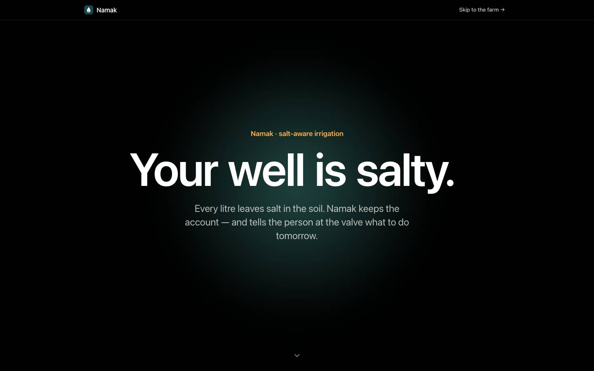
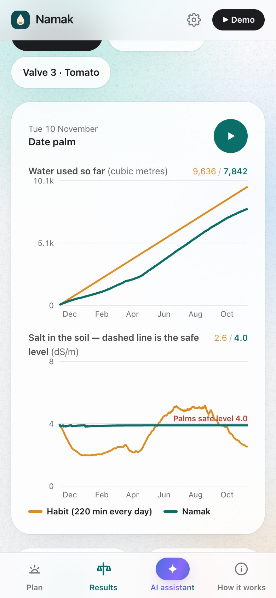
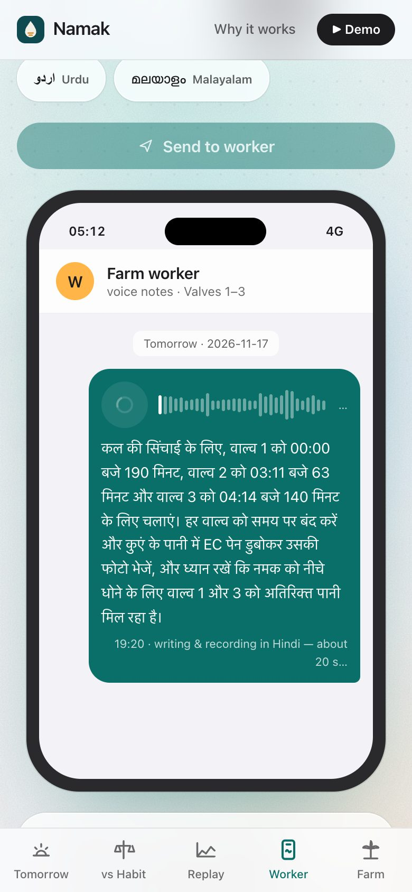
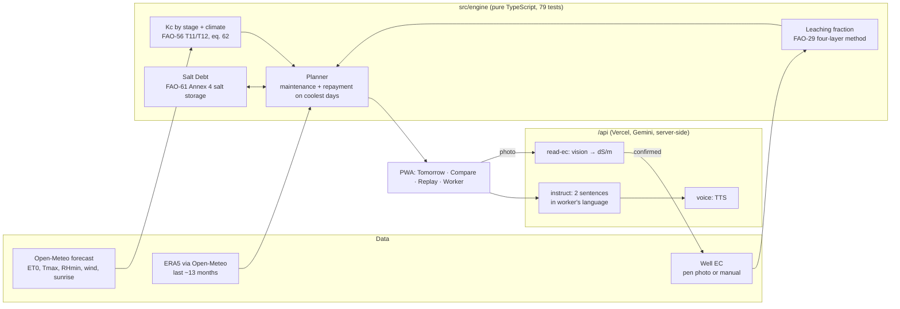

# Namak — the salt-debt irrigation planner for desert farms

> **Your well is salty. Every drop you pour adds to a salt debt your soil has to repay.
> Namak tells your worker exactly how many minutes to open each valve tomorrow — and when to pay the debt down.**

**Live:** https://namak-phi.vercel.app · **Problem:** Breaking Bytes A-001 “Smart Farming for the Desert” · built 16–17 Nov 2026

*Namak* means salt in Hindi, Urdu and Persian.

<p>

</p>
<p>




</p>

---

## The problem inside the problem

Everyone asks *“how much water does the crop need?”* In the desert that is only half the question.

1. **Salt is the hidden water cost.** Many desert wells are brackish. To stop salt building up, some water
   must drain past the roots and carry the salt away — the *leaching requirement* (FAO-29). Growers guess it: too little
   and the soil slowly poisons the crop; too much and the scarcest input on the farm is wasted. Nobody calculates it.
2. **Salt Debt.** Every litre of brackish water leaves salt behind. Namak keeps a running balance of root-zone salt
   against each crop’s tolerance — a debt — and schedules the repayment (extra leaching) on the coolest days of the week,
   when the crop is using least water. FAO-29 explicitly supports this timing (see [Debt repayment](#debt-repayment-is-it-allowed)).
3. **The decision-maker isn’t at the valve.** The owner decides; a hired worker — who may not read English — opens the
   valves by habit (“45 minutes, every day”). Namak sends tomorrow’s exact minutes as a **voice note in the worker’s
   language**, and the worker closes the loop by photographing a ~AED 100 EC pen. AI reads the display; the plan updates.

## What it does (6 screens, mobile-first, no login)

First visit opens a welcome screen with two choices: **Watch the demo (60 s)** — a guided walkthrough that drives the real
app by itself with plain-English captions (the slider moves, the voice note plays, a meter photo is read and confirmed;
the farm is restored afterwards) — or **Explore on my own**. A scrolling story (“Your well is salty.”) is one tap away.
Every screen explains the idea from scratch in everyday words; the technical maths sits behind “How we worked this out”.


| Screen | What you see |
|---|---|
| **Tomorrow** | Total watering time, a card per valve (“Valve 1 · Palms · 95 min · 00:00 → 01:35”), one-line *why* (heat + salt), a Salt Debt gauge, blend advice, and the 7-day plan with repayment days marked. |
| **Habit vs Namak** | A year of real weather at the farm. Drag the **well-EC slider** and the salt water cost, water/AED saved and yield risk change live; when the water is too salty for a crop, Namak shows the RO/TSE **blend ratio**. |
| **Season Replay** | Last year re-run day by day on **ERA5 reanalysis weather**: cumulative water and root-zone salt, habit vs Namak, animated. This is the proof that the decision beats the guess. |
| **Worker** | Phone mock-up. *Send to worker* → two sentences in English, Arabic, Hindi, Urdu or Malayalam, played as a voice note. *Worker sends EC reading* → photo of the pen → AI reads it → owner confirms → plan recalculates with a visible diff. |
| **Farm** | Location, well EC, blend water, valves (crop, plants, spacing, emitters, flow), soil test, the worker’s habit. Saved on the phone. |
| **Why it works** | Sources, formulas, crop constants, real vs illustrative, limits, cost. |

## Does the decision beat the guess?

Illustrative demo farm near Al Ain (30 date palms, 1 000 m² fodder, 600 m² tomato; well 3.2 dS/m), replayed on **real
ERA5 weather, 11 Nov 2025 – 10 Nov 2026** (tomato: its Oct–Mar season). Habit = the worker’s summer setting left on all year.

| | Habit | Namak |
|---|---|---|
| Water, whole farm, 12 months | 14 686 m³ | **11 904 m³ (−19 %, ≈ AED 4 170/yr)** |
| Of which spent flushing salt | not budgeted | 2 230 m³ (the hidden cost, now visible) |
| Date palm: days with root-zone salt over the limit | 120 | **1** |
| Fodder: days over the limit | 89 | **0** |
| Tomato: salt-limited yield | 87 % | **100 %** (needs 36 % RO water in the blend; uses ~2 % more water than habit) |

These numbers are asserted in [`src/engine/demo-claims.test.ts`](src/engine/demo-claims.test.ts) so they cannot drift
silently. Namak is **not** always the lower-water option: on the salt-sensitive tomato it spends slightly more water and
saves the crop. That is the point — water goes where the salt demands it, not where habit puts it.

## How it works



### Formulas (units: mm over crop area, 1 mm on 1 m² = 1 L; EC in dS/m)

| Step | Formula | Source |
|---|---|---|
| Crop water | ETc = Kc × ET0 | FAO-56 eq. 56 |
| Kc curve | flat Kc ini → linear to Kc mid → flat → linear to Kc end | FAO-56 ch. 6, Tables 11–12 |
| Climate adjustment | Kc = Kc(tab) + [0.04(u2−2) − 0.004(RHmin−45)](h/3)^0.3 | FAO-56 eq. 62 |
| Wind at 2 m | u2 = u10 · 4.87 / ln(67.8·10 − 5.42) | FAO-56 eq. 47 |
| Leaching requirement (cross-check) | LR = ECw / (5·ECe − ECw) | FAO-29 eq. 9 |
| Leaching fraction used | LF such that steady-state four-layer root-zone ECe = target (40-30-20-10 % uptake) | FAO-29 / FAO 1985b; FAO-61 Annex 4 Table A4.1 |
| Gross water | Gross = ETc / ((1 − LF) × drip efficiency) | FAO-29 eq. 7 |
| Valve time | minutes = litres / (emitters × L/h) × 60 | — |
| Salt Debt (daily) | ΔS = (IW·ECiw − R·S/Wfc) / (1 + R/2Wfc), four quarters, ECe ≈ ECsw/2 | FAO-61 Annex 4 eq. 19–23 |
| Yield | Y = 100 − b·(ECe − threshold) | FAO-29 Table 4 / FAO-56 Table 23 |
| Target ECe | 100 % yield ECe if ECw > 1.5 dS/m, else 90 % yield ECe | FAO-29 §2.4.2 |
| Blend | x = (ECwell − ECmax) / (ECwell − ECclean); ECmax keeps LF ≤ 0.25 | mass balance; FAO-29 (“LR > 0.25–0.30 may not be practical”) |

**Validation against FAO’s own worked numbers** (all in the test suite):
FAO-29 Example 3 (LR 0.106 / 0.164; 800 mm ET → 889 mm applied) · FAO-61 Table A4.1 concentration factors
(LF 0.05 → 3.2, 0.10 → 2.1, 0.15 → 1.6, 0.20 → 1.3, 0.30 → 1.0) · FAO-56 slope at FAO-29’s 90 % ECe gives 90 ± 2 % yield
for every crop.

**Why not just FAO-29 eq. 9?** Run inside the FAO-61 salt model, eq. 9’s quick estimate settles slightly *above* the
crop limit (≈ 4.5 vs 4.0 dS/m for palms at 3.2 dS/m water). Namak uses FAO-29’s more exact four-layer method so the
daily plan and the debt model agree; eq. 9 is still computed and shown for comparison.

### Debt repayment: is it allowed?

Yes. FAO-29 §2.4.2: leaching *“can be done at each irrigation, each alternate irrigation or less frequently, such as
seasonally … as necessary to keep salinity below the threshold”*, and *“schedule leachings at periods of low crop water
use”* / *“leach during the cool season instead of the warm”*. Namak therefore applies maintenance leaching every day and,
when the root zone is (or is about to be) over the limit, adds repayment on the **lowest-ET0 days** of the week, at most
doubling a day’s water so no valve is flooded.

Valves run one after another (one pump) at night, finishing by sunrise. Night/pre-dawn timing is a design choice, not an
FAO number: evaporation and wind losses are lowest and the water is in the root zone before the afternoon peak.

### Crop constants (all read from the primary FAO pages on 16 Nov 2026)

| Crop | Kc ini / mid / end (FAO-56 T12) | Stages, days (FAO-56 T11) | Root depth used, m (T22) | ECe 100 % / 90 % / 0 % (FAO-29 T4) | b, %/dS·m⁻¹ (FAO-56 T23) |
|---|---|---|---|---|---|
| Date palm | 0.90 / 0.95 / 0.95 | perennial | 1.5 (of 1.5–2.5) | 4.0 / 6.8 / 32 | 3.6 |
| Tomato | 0.6 / 1.15 / 0.80 (range 0.70–0.90) | 35/45/70/30 (Oct/Nov, arid) | 0.7 (of 0.7–1.5) | 2.5 / 3.5 / 13 | 9.0 |
| Cucumber | 0.6 / 1.00 / 0.75 | 25/35/50/20 (Nov/Feb, arid) | 0.7 (of 0.7–1.2) | 2.5 / 3.3 / 10 | 13.0 (range 7–13) |
| Lettuce | 0.7 / 1.00 / 0.95 | 25/35/30/10 (Oct/Nov, arid) | 0.3 (of 0.3–0.5) | 1.3 / 2.1 / 9.0 | 12.0 |
| Fodder grass (Bermuda) | 0.55 / 1.00 / 0.85 | perennial | 1.0 (of 1.0–1.5) | 6.9 / 8.5 / 23 | 6.4 |

Other constants: sand field capacity θFC = 0.12 (FAO-56 Table 19 midpoint of 0.07–0.17); practical LR limit 0.25
(FAO-29). **UNVERIFIED:** drip application efficiency 0.90 — a common design value we did not find in a primary FAO
table; it is editable in Farm setup. Rhodes grass (the usual UAE fodder) is in neither FAO salt table, so Bermuda grass,
the nearest listed fodder grass, stands in for it.

## Data: what is real, what is illustrative

| Real | Illustrative |
|---|---|
| 7-day forecast: Open-Meteo (`et0_fao_evapotranspiration`, `temperature_2m_max`, `relative_humidity_2m_min`, `wind_speed_10m_mean`, `sunrise`) | The demo farm’s layout, crops, emitters and the worker’s habit |
| Historical weather: ERA5 reanalysis via Open-Meteo Archive API (`models=era5`) | Well EC (3.2 dS/m) and soil tests |
| FAO crop and salt constants, FAO equations | Water price (AED 1.5/m³) and the RO blend water EC |
| Gemini output (instructions, voice, EC reading) | The three sample EC-pen photos are drawings made for the demo |

Every number in the UI carries a source tag (“Live forecast · Open-Meteo”, “Historical weather · ERA5 via Open-Meteo”,
“Illustrative well EC”). A real-weather snapshot for the demo location is bundled so the demo works with no network.

## Desert rules

- **Water:** −19 % on the demo farm over a real year, and the salt share of every litre is made visible and budgeted.
- **Weak connectivity, little time:** installable PWA; after one load every screen works offline with an
  “Offline — plan synced …” banner; the last forecast, instructions and recorded voice notes are cached. One sync a week
  is enough to keep a 7-day plan. The worker needs no reading and no app — a voice note.
- **Affordable:** an EC pen (~AED 100) is the only hardware. No sensors, no subscription. AI calls are small (two sentences, a few seconds of
  audio, one photo) and capped per day.

## How AI is used (Gemini, server-side only)

| Route | Model | Does | Guard rails |
|---|---|---|---|
| `/api/instruct` | `gemini-4-hydrogen` (thinking: low) | Plan → 2 sentences in the worker’s language | Every minute and start time is checked against the plan; if anything differs, too slow or offline → deterministic template |
| `/api/voice` | `gemini-3.8-flash-lite-tts` | Text → voice note (WAV) | Prefetched when the screen opens; fallback: phone’s own TTS, then committed recorded samples |
| `/api/read-ec` | `gemini-4-hydrogen` vision, strict JSON schema | Photo → value + unit | mS/cm = dS/m, µS/cm ÷ 1000, ppm rejected, 0–20 dS/m only; owner must confirm; manual entry fallback |

The key lives only in Vercel’s environment (`GEMINI_API_KEY`); per-IP limits and a daily cap protect the quota. Model IDs
and request formats were taken from Google’s docs on 16 Nov 2026 (Interactions API, `Api-Revision: 2026-05-20`).
The AI never decides minutes: the engine does; AI only translates, speaks and reads a display.

## Assumptions & limitations

- Salt model: complete mixing within four root-zone layers, 40-30-20-10 % uptake, no capillary rise, adequate drainage,
  no salt from fertiliser or rain, no precipitation/dissolution chemistry; daily time step; soil back at field capacity
  after each drip irrigation.
- Kc values are for healthy full cover; young or sparse plantings use less. Root depth uses the low end of FAO ranges.
- Yield response covers salinity only (not water stress, not sodium/chloride/boron toxicity — FAO-29 §4).
- The EC pen measures **water**, so the photo updates the well EC; soil salinity is modelled between soil tests.
- Season Replay gives Namak a perfect 7-day forecast (the recorded weather); real forecasts are less accurate.
- The demo farm is illustrative and has not been field-validated. Non-English templates have not yet been checked by
  native speakers.

## Run it

```bash
npm install
npm test            # 79 tests: engine, FAO cross-checks, demo claims, weather fallback, instruction checks
npm run dev         # UI on http://localhost:5173 (AI routes need vercel dev)
```

With the AI routes:

```bash
echo "GEMINI_API_KEY=..." > .env.local         # never commit; .env* is git-ignored
set -a; . ./.env.local; set +a; vercel dev
```

Deploy: `vercel env add GEMINI_API_KEY production`, then `vercel --prod`. Refresh the bundled weather snapshot with
`node scripts/snapshot-weather.mjs`; regenerate the recorded voice samples with `npx tsx scripts/make-sample-voice.mts`.

**Stack:** Vite · React 19 · TypeScript · Tailwind v4 · Motion (animation) · Recharts · vite-plugin-pwa · Vitest · Vercel functions · Gemini.
Type: the device's system font (SF Pro on Apple devices), Inter elsewhere. All animation respects `prefers-reduced-motion`.

## Sources

- FAO Irrigation & Drainage Paper 29 Rev. 1, *Water quality for agriculture* — https://www.fao.org/3/t0234e/T0234E03.htm
- FAO-56, *Crop evapotranspiration*, ch. 6 — https://www.fao.org/3/X0490E/x0490e0b.htm · ch. 7 (Table 19) — https://www.fao.org/3/X0490E/x0490e0c.htm · ch. 8 — https://www.fao.org/3/X0490E/x0490e0e.htm
- FAO Irrigation & Drainage Paper 61, Annex 4 — https://www.fao.org/3/Y4263E/y4263e0h.htm
- Open-Meteo Forecast and Historical Weather (ERA5) APIs — https://open-meteo.com/en/docs · https://open-meteo.com/en/docs/historical-weather-api
- Gemini API docs (models, structured output, image understanding, speech generation, thinking) — https://ai.google.dev/gemini-api/docs

## How this was built

Built solo by **Aryesh Biswas** within the hackathon window, 16–17 Nov 2026 (see the commit history).
